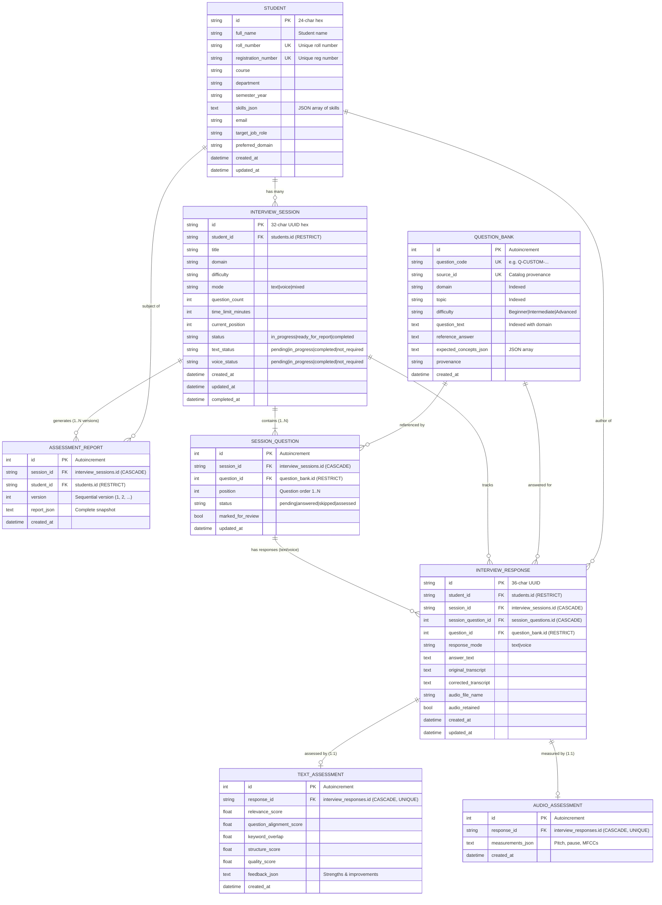

# InterviewAI — Database Relationship & Schema Audit

**Database Engine:** SQLite 3  
**ORM:** SQLAlchemy 2.x Declarative  
**Connection Settings:** Foreign Keys ON (`PRAGMA foreign_keys=ON`), WAL Mode (`PRAGMA journal_mode=WAL`), 30s timeout  
**Production DB File:** `data/interviewai.sqlite3`  

---

## 1. Relational Entity-Relationship Diagram

---

## 2. Table Inspection & Schema Validation

### 2.1 Constraint Verification
1. **Foreign Key Integrity:**
   - Deleting an `InterviewSession` automatically cascades to `SessionQuestion`, `InterviewResponse`, `TextAssessment`, `AudioAssessment`, and `AssessmentReport`.
   - Deleting a `Student` is **restricted** (`ondelete="RESTRICT"`) if they have active sessions or responses.
   - Deleting a `QuestionBank` question is **restricted** if it is referenced in an active session question or response.
2. **Uniqueness Constraints:**
   - `students.roll_number` & `students.registration_number` are strictly enforced unique.
   - `question_bank(domain, question_text)` ensures zero duplicate questions within a domain.
   - `session_questions(session_id, position)` prevents order collision.
   - `interview_responses(session_question_id, response_mode)` enforces exactly one text and/or one voice response per question.
   - `assessment_reports(session_id, version)` enforces strict report version uniqueness.

### 2.2 Shared Session Workflow (Text & Voice)
- **Finding:** The architecture correctly allows a single session to handle both text and voice modes:
  - Each `SessionQuestion` can link up to two `InterviewResponse` records: one for `text` and one for `voice`.
  - The session tracks `text_status` and `voice_status` independently (`pending` → `in_progress` → `completed`).
  - Only when all required modes are completed can a final report be compiled.

### 2.3 Live Production DB State
- `students`: 1 record (`Aryan kumar`).
- `question_bank`: 61 curated questions across 12 domains.
- `interview_sessions`: 4 sessions.
- `session_questions`: 20 assigned questions.
- `interview_responses`: 2 recorded answers.
- `text_assessments`: 2 scored responses.
- `audio_assessments`: 0 recorded acoustic sessions.
- `assessment_reports`: 0 finalized reports.

