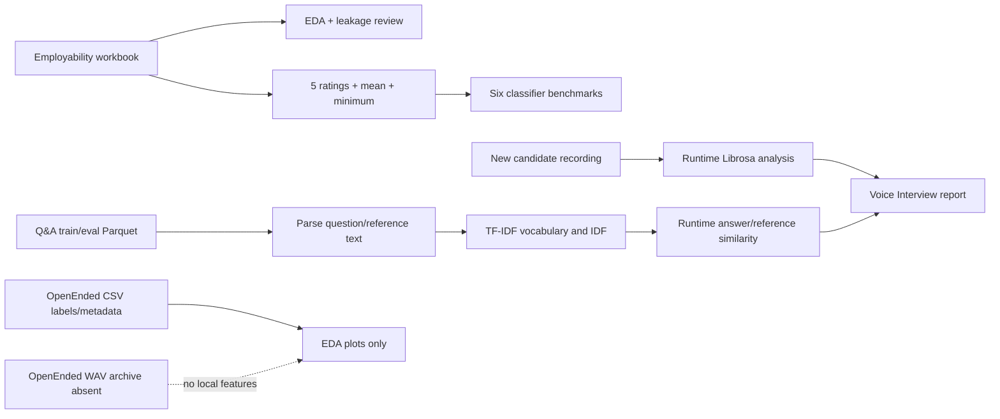

# Dataset and EDA Analysis

## Scope and source of counts

This audit read the repository's `reports/dataset_inventory.csv`, EDA/model reports, dataset documentation, schemas/templates, and source readers. Counts and quality summaries below reproduce the existing EDA/docs; they were not recomputed from every row during this documentation-only task. The file listing confirms the spreadsheet, two Parquet shards, four OpenEnded CSVs, and custom template are present. It confirms that the OpenEnded WAV archive and Common Voice files are absent.

## Dataset inventory

| Dataset/file | Format, size | Rows × columns | Columns/target | Missing/duplicates/class balance | Actual role in code |
|---|---|---:|---|---|---|
| Student Employability (`dataset/employability/Student-Employability-Datasets.xlsx`, sheet `Data`) | Excel, about 135 KB | 2,982 × 10 | 9 input-like columns plus `CLASS`; target is binary `CLASS`. | Existing EDA reports zero missing and zero duplicate rows. `Employable`: 1,729 (58%); `LessEmployable`: 1,253 (42%). | **Only supervised model training/evaluation dataset** (`src/employability_pipeline.py`). |
| AI Interview Questions train (`dataset/interview_questions/train-00000-of-00001.parquet`) | Parquet, about 769 KB | 4,653 × 1 | Single `text` field containing `<s>[INST] question [/INST] answer</s>` records. No target label. | EDA reports no missing `text`, no duplicate records, and all rows parse into nonempty Q/A. | Reference corpus used to fit TF-IDF together with eval corpus; retrieval/reference data, not graded answer training. |
| AI Interview Questions eval (`dataset/interview_questions/eval-00000-of-00001.parquet`) | Parquet, about 195 KB | 1,164 × 1 | Same `text` schema. No target label. | Existing EDA reports no missing `text`, no duplicates, and parse succeeds. | Reference corpus; also included in vectorizer fit in `run_text_pipeline()`. API caches first 50 eval rows for its questions endpoint, though the current Streamlit categories use hard-coded questions instead. |
| OpenEnded Gemini train (`dataset/openended/gemini2_train.csv`) | CSV, about 143 KB | 6,109 × 4 | `wavname`, `Accuracy`, `Fluency`, `Prosody`; three 1–5 AI scores. | Existing EDA gives means 3.14, 2.73, 2.58 for the three ratings. These are score distributions, not class labels. | EDA only; no audio-feature model is trained. |
| OpenEnded Gemini dev (`dataset/openended/gemini2_dev.csv`) | CSV, about 63 KB | 2,673 × 4 | Same schema as Gemini train. | Existing reports say labels are populated; no distribution metrics were independently recalculated for this audit. | EDA only. |
| OpenEnded human test (`dataset/openended/human_test.csv`) | CSV, about 59 KB | 1,000 × 13 | `wavname`; A1/A2/A3 scores for Accuracy/Fluency/Prosody; final averaged `Accuracy`, `Fluency`, `Prosody` floats. | Existing EDA shows averaged means: Accuracy 3.28, Fluency 2.98, Prosody 3.49. Human annotations are present for a test split. | EDA only. Not scored by a model in this repository. Existing EDA reports zero overlap between this set's `wavname`s and Gemini train/dev, so the C8 AI-vs-human comparison is skipped. |
| OpenEnded metadata (`dataset/openended/meta_data.csv`) | CSV, about 1,018 KB | 9,782 × 4 | `wavname`, `user_id`, `question`, `split`. No target. | EDA reports one missing `question`, no missing values in other columns, 1,003 users, about 1,131 unique questions; train/dev/test counts 6,109/2,673/1,000. | EDA metadata summary only; it is not joined into the runtime interview scorer. |
| OpenEnded audio archive `wav.zip` | ZIP, estimated ~6.71 GB | about 9,782 recordings | Audio referenced by `wavname`. | Not present in the checkout. | No training or feature extraction from this corpus is possible with the local files. |
| Mozilla Common Voice | No downloaded file | — | Placeholder/recommended dataset only. | Not present in the audited file listing. | Not used. |
| Custom assessment template (`dataset/custom/interview_answer_assessment_template.csv`) | CSV, under 1 KB | 0 data rows × 9 columns | candidate/question identifiers, question, candidate and reference answers, relevance/structure/quality scores, human label. | Empty header-only template. | Future collection template; no text-quality ground truth is currently trained on it. |

## Schemas in more detail

### Employability workbook

The 10 columns are `Name of Student`, `GENERAL APPEARANCE`, `MANNER OF SPEAKING`, `PHYSICAL CONDITION`, `MENTAL ALERTNESS`, `SELF-CONFIDENCE`, `ABILITY TO PRESENT IDEAS`, `COMMUNICATION SKILLS`, `Student Performance Rating`, and `CLASS`. The five selected model ratings plus `soft_skill_mean` and `soft_skill_min` form the seven model inputs. Appearance, physical condition, student identifier, and performance rating are excluded. The training code keeps the target as category strings; `LabelEncoder` is imported but not used for the target.

### Interview Q&A parquet

It has one combined `text` column, not explicit question/answer columns. `parse_instruction_parquet()` extracts the two segments with regex. Existing EDA reports mean train lengths of 11.6 question words and 37.4 answer words; eval means are 11.5 and 37.1. The corpus has no human quality labels, topic labels, or difficulty labels. Because the supplied answers are references, similarity to them is not the same as a human judgment of correctness.

### OpenEnded CSVs

The annotation tables contain scalar target-like ratings, but the acoustic WAV files they reference are missing. `src/eda_runner.py` plots ratings, correlations, annotator correlations, question frequencies, and split sizes. It does not assemble an audio feature matrix or train a regressor/classifier. Metadata lists 9,782 recordings while train+dev+test annotations total 9,782; that equality is consistent with split coverage but does not provide the audio bytes.

## Dataset flow: do not conflate the three tasks

No code merges these sources into one multimodal training dataset. Candidate audio used at runtime is a separate live input and has no stored ground-truth label attached in this project.

## EDA outputs present

- Employability A1–A6: class distribution, feature distributions, class comparisons, correlations, boxplots, mean-score comparisons.
- Interview questions B1–B5: split sizes, length distributions, top words, question starters, answer length by type.
- OpenEnded C1–C7: split sizes, AI/human rating distributions, score correlations, annotator correlations, question counts. C8 is not in the file listing and the report says it was skipped because of zero overlap.
- Employability E1–E11: target correlations, split, CV, validation/test confusion matrices, comparisons, ROC plots, feature importance, tree visualization.

## Data interpretation caveats

1. Employability labels and features are subjective interview-assessor judgments. A good held-out score can reproduce those judgments without proving labor-market employability.
2. The 58/42 class imbalance is moderate, not severe; code uses stratification and balanced weights in some estimators, but no resampling.
3. The EDA documentation says there are zero duplicate rows in Dataset A and zero duplicate records in Dataset B; the audit did not recompute those counts from source rows.
4. The report says all train/eval Q&A rows parse cleanly, but vectorizer fit includes both Q&A splits. This is not an answer-label leak (there are no answer-quality labels), though it means the held-out text split is not isolated from vocabulary/IDF fitting.
5. The Dataset C labels could support a future supervised speech-quality model only if aligned audio features are obtained and evaluation is designed carefully. Current runtime Librosa metrics are not trained against those labels.

## Documentation inconsistencies

`documentation/DATASET_DOCUMENTATION.md` says “Setup Phase — No model training has begun” and describes model/audio training as future work. This conflicts with the existing trained `.joblib` artifacts and completed EDA/model reports. Some `eda_summary_report.txt` “Next” bullets are also future plans, not evidence that clustering or OpenEnded acoustic training exists. The main README and changelog describe later app capabilities than the dataset document.
