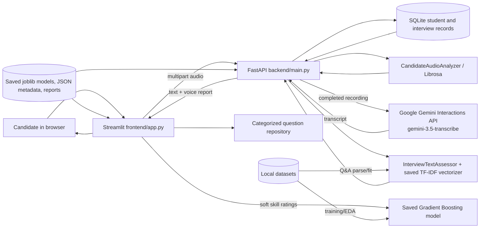
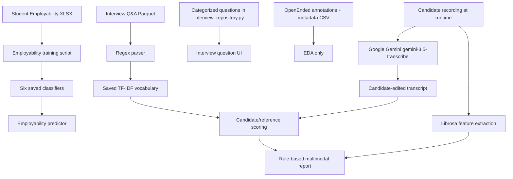

# Project Architecture and File Map

Paths and line references below are approximate because the application has changed since the original audit. Current setup details are in `README.md`; phase outcomes are in `IMPLEMENTATION_STATUS.md`.

## 1. System shape

The diagram shows separate paths: the employability classifier does not consume interview text or audio. The `POST /api/interview/multimodal-report` route joins text scores and acoustic features in a single response only. There is no trained fusion estimator.

## 2. Directory responsibilities

| Path | Contents / role |
|---|---|
| Repository root `README.md` | Short project title/description. |
| Repository root `.gitignore` | Ignores environment, cache, and common generated files; `.env` is ignored. |
| Repository root `.env.example` | Placeholder `GEMINI_API_KEY`; contains no secret. |
| `Intelligent_Mock_Interview/README.md` | Main setup, dataset, app, voice interview, and persistence instructions. |
| `backend/` | FastAPI app and persistent management API router. |
| `frontend/` | Single Streamlit app in `app.py`. |
| `src/` | ML training, EDA, text/audio processing, SQLAlchemy models, question repository, and tests. |
| `data/` | Seed question bank and ignored local SQLite database/WAL files. |
| `dataset/employability/` | Student employability Excel file. |
| `dataset/interview_questions/` | Train/eval AI Q&A Parquet shards. |
| `dataset/openended/` | Four annotation/metadata CSVs; no WAV archive. |
| `dataset/custom/` | Empty answer-assessment template. |
| `dataset/common_voice/` | Mentioned as reserved in docs but no files in the audited listing. |
| `models/` | Six `.joblib` estimators, TF-IDF vectorizer, model metadata JSON. |
| `notebooks/` | Four experiment notebooks; no saved outputs. |
| `reports/` | EDA/model/text reports, inventory, and one sample WAV. |
| `reports/figures/` | A-series EDA, B-series Q&A, C-series OpenEnded, E-series model plots. |
| `documentation/` | Existing dataset guide and these audit documents. |
| `requirements.txt` | Dependency minimum versions. No lockfile. |
| `download_dataset.py` | Hugging Face Q&A shard downloader. |

## 3. Module responsibilities and entry points

### Frontend: `frontend/app.py`

- `load_models_and_resources()` (line 47) is cached with `st.cache_resource`; loads the Gradient Boosting artifact, fitted vectorizer, metadata, audio analyzer, and up to 50 Q&A records.
- Sidebar navigation starts around line 189. Sections are Dashboard, Employability Predictor, Technical Interview (Text), Voice Interview, Multimodal Report, and Model Performance & EDA.
- Employability prediction around lines 349-456 constructs the same five ratings plus `soft_skill_mean` and `soft_skill_min`, calls the loaded model locally, and saves the result in Streamlit session state.
- Technical text interview around lines 458-564 takes categorized hard-coded questions, runs `text_assessor.assess_answer`, and stores `last_text_eval`.
- Voice Interview around lines 567-672 uses `st.audio_input` or `st.file_uploader`, retains bytes/transcript/report in `st.session_state`, posts to the two new API routes, and displays the report.
- A separate older audio branch remains around lines 674-762 but is not in the navigation options. It uses direct local extraction and has the old “estimated fluency/prosody” display.
- The older Multimodal Report around lines 773-842 remains navigable and is separate from the new Voice Interview report. It combines prior session results and substitutes neutral values when a modality is absent.
- The benchmark/EDA page around lines 844-910 reads `model_meta` and saved figures.

### Backend: `backend/main.py`

- A single `FastAPI` instance is created around lines 30-34.
- `load_dotenv(ROOT_DIR/.env)` (lines 21-23) reads the repo-root secret. Resource initialization around lines 143-177 loads model files and question Parquet at process import/startup.
- `_validate_audio_bytes()` (line 47) checks extension, empty payload, 25 MiB cap, magic/container bytes, and MIME compatibility.
- `_get_gemini_client()` creates a bounded Google Gen AI client when `GEMINI_API_KEY` is configured.
- `_analyze_audio_bytes()` (line 93) writes a temporary suffixed file, uses the existing audio analyzer, derives WPM/filler count from corrected transcript, filters non-finite values, and removes the temporary file in `finally`.
- `GET /` lists routes.
- `GET /api/v1/questions` returns a prefix of cached Parquet question rows; default limit is 15.
- `POST /api/audio/transcribe` accepts multipart `file`; uploads the recording and calls Gemini `gemini-3.5-transcribe` through the Interactions API.
- `POST /api/interview/multimodal-report` (line 262) accepts form `question`, `reference_answer`, `corrected_transcript` and multipart `file`; returns text and voice blocks plus evidence-based heuristic feedback.
- `POST /api/v1/predict/employability` (line 330) validates five integer inputs 1–5, engineers two aggregate features, and returns class/probabilities/recommendations.
- `POST /api/v1/assess/text` (line 389) accepts JSON `question`, `candidate_answer`, and optional reference and returns score dimensions/tier/feedback.
- `POST /api/v1/assess/audio` (line 436) accepts older WAV/MP3 flow and returns acoustic metrics/feedback.
- `POST /api/v1/assess/multimodal` (line 478) is an older separate route; it combines employability classification, text, and optional audio and has weaker input/model guards than the newer report route.

The API enables wildcard CORS with credentials in the existing configuration. This is broader than needed for a local Streamlit-to-local-API setup.

### Reusable processing modules

| Symbol | Path / lines | Actual behavior |
|---|---|---|
| `clean_text` | `src/text_pipeline.py:67` | Lowercase, strips instruction tags, deletes ASCII punctuation, collapses whitespace. |
| `tokenize_content_words` | `src/text_pipeline.py:81` | Uses the cleaner, splits on whitespace, filters a fixed stopword set and one-character tokens; no stemming/lemmatization. |
| `parse_instruction_parquet` | `src/text_pipeline.py:88` | Extracts question/answer using `[INST]...[/INST]` and `</s>` regexes. |
| `InterviewTextAssessor` | `src/text_pipeline.py:121` | Fits a scikit-learn TF-IDF vectorizer and calculates cosine/Jaccard/structure/composite values. |
| `CandidateAudioAnalyzer` | `src/audio_feature_extractor.py:35` | Loads audio at target 16 kHz mono by default, extracts RMS, silence intervals, YIN F0, and mean MFCCs. |
| `CATEGORIZED_QUESTIONS` | `src/interview_repository.py` | Hard-coded question and reference-answer bank for eight technical categories. |
| `run_text_pipeline` | `src/text_pipeline.py:265` | Parses Q&A files, fits vectorizer on train plus eval question/answer text, saves vectorizer and demonstration report. |
| `src/eda_runner.py` top-level body | script | Reads the three dataset groups and writes inventory-derived summary figures/report; not a callable library pipeline. |
| `src/employability_pipeline.py` top-level body | script | Executes model training/evaluation at import/run time; no `main()` guard. Importing it can have side effects. |

## 4. Dataset-to-module map

The AI Q&A Parquet data is separately loaded by the API for `/api/v1/questions`, but the current Voice Interview page question selector uses `interview_repository.py` rather than those cached API questions. The data sets are not merged into a shared training table.

## 5. Outputs, persistence, and operational behavior

- Student profiles, question bank entries, interview sessions, text/voice responses, assessments, and versioned final reports are persisted in SQLite. Temporary audio bytes remain in Streamlit session state and are analyzed then discarded by the backend.
- New audio bytes are transmitted from Streamlit to FastAPI for transcription and again for report extraction. The report route temporarily writes a file for Librosa and deletes it in `finally`.
- The Gemini key is backend-side. It is loaded from root `.env`, and no route intentionally returns it.
- Saved model files and metadata are local project artifacts. Startup uses `joblib.load`; do not load artifacts from untrusted sources.
- There is no account authorization, deployment manifest, or containerization in the repository. Interview sessions are persisted, but they are not protected by user authentication.

## 6. Architectural caveats

1. `/api/v1/assess/multimodal` is not the new integrated report route. Its title/response might suggest all-in-one interview grading, but it adds employability class prediction to an uncalibrated text heuristic and optional audio metrics.
2. The older Streamlit “Multimodal Report” substitutes `0.50` for missing modality values, which can make a partial score appear complete. The separate newer Voice Interview flow is more coherent and reports text/voice separately.
3. The `raw_questions` loaded by Streamlit and API's `cached_questions` do not drive the categorized question selector.
4. API startup wraps all resource loads in a broad exception handler. A failure partway through can leave some globals loaded and others absent; endpoints vary in whether they guard the missing resource.
5. Audio upload validation is stronger on the new routes than on the legacy audio endpoints. No auth/rate limit is present.
