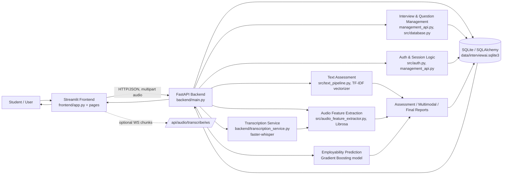
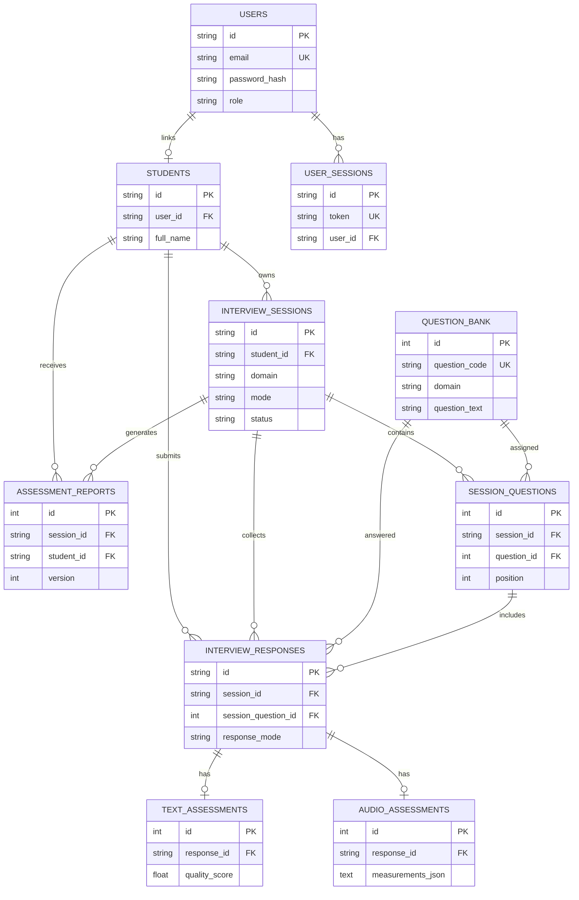

# InterviewAI – Intelligent Multimodal Mock Interview Assessment System

InterviewAI is a full-stack academic prototype for conducting simulated technical/mock interviews and generating interpretable, practice-oriented feedback from candidate responses. The project combines a Streamlit frontend, a FastAPI backend, SQLAlchemy-backed persistence, TF-IDF/text-heuristic scoring, Librosa-based acoustic feature extraction, local faster-whisper speech transcription, and a soft-skill employability prediction model.

- **Repository:** https://github.com/ARYANKUMAR210107/Multimodal-Mock-Interview
- **Primary application path:** `Intelligent_Mock_Interview/`
- **API docs (local):** `http://127.0.0.1:8000/docs` (when backend is running)

> **Documentation scope:** This README documents features and components present in the source code and repository artifacts. Partially implemented, unverified, or planned capabilities are labeled explicitly.

## Table of Contents

- [Project Overview](#project-overview)
- [Key Features](#key-features)
- [Complete Technology Stack](#complete-technology-stack)
- [System Architecture](#system-architecture)
- [Project Directory Structure](#project-directory-structure)
- [Machine Learning Implementation](#machine-learning-implementation)
- [Text Assessment Pipeline](#text-assessment-pipeline)
- [Audio Assessment Pipeline](#audio-assessment-pipeline)
- [Multimodal Assessment](#multimodal-assessment)
- [Database Design](#database-design)
- [API Documentation](#api-documentation)
- [Installation and Setup](#installation-and-setup)
- [Environment Variables](#environment-variables)
- [How to Use the Application](#how-to-use-the-application)
- [Testing and Results](#testing-and-results)
- [Limitations and Future Scope](#limitations-and-future-scope)
- [Security and Privacy](#security-and-privacy)
- [Screenshots and Demonstration](#screenshots-and-demonstration)
- [Contribution and License](#contribution-and-license)

## Project Overview

### Project Title and Introduction
**InterviewAI – Intelligent Multimodal Mock Interview Assessment System** is designed to help students practice interview responses and receive structured feedback from both textual and speech-derived signals. It is implemented as a local/web-style application with separate frontend and backend services and a persistent SQLite database for development.

### Problem Statement
> Develop a machine learning system that conducts simulated interviews and evaluates candidate responses. The system should analyze both the content of responses and relevant communication characteristics. Students should investigate how speech and textual features can be used to estimate aspects such as answer relevance, fluency, structure, confidence and response quality while providing interpretable feedback.

### Project Motivation
Traditional interview preparation often lacks consistent, explainable feedback on both *what* a candidate says and *how* it is delivered. InterviewAI explores a multimodal assessment workflow where text similarity/structure heuristics and acoustic measurements can be presented together to support practice and reflection.

### Main Objectives
- Provide a student-facing workflow for registration/login, interview setup, answering, assessment, and report review.
- Persist students, interview sessions, question assignments, responses, assessments, and reports in a relational database.
- Evaluate written/transcribed answers against question/reference context using interpretable NLP heuristics.
- Extract descriptive acoustic/prosodic measurements from recorded or uploaded audio.
- Transcribe speech using a locally running transcription service (faster-whisper) and allow transcript review/editing.
- Combine available text and voice findings into a multimodal report without fabricating unsupported scores.
- Preserve and expose a trained employability prediction model for soft-skill inputs.

### Proposed Solution
The system uses a Streamlit UI for interaction, FastAPI for API/inference/reporting endpoints, SQLAlchemy models for durable records, a TF-IDF-based text assessor for reference/question alignment heuristics, Librosa for audio measurements, faster-whisper for local speech-to-text, and pre-trained scikit-learn employability models (best model: Gradient Boosting) for employability prediction.

### Project Scope
**In scope (implemented or partially implemented):** local development deployment, student/auth flows, interview session creation and persistence, question bank APIs/UI, text and voice response capture paths, HTTP audio transcription, audio feature extraction, multimodal/text/audio assessment endpoints, report generation/storage, and saved ML artifacts/evaluation reports.

**Out of scope / not verified as complete:** production-grade deployment hardening, guaranteed real-time browser chunk-streaming UX end-to-end, external speech API dependency as primary path, full admin governance UX, and independent human-calibrated scoring validity.

### Target Users
- Students/candidates practicing technical or behavioral interview responses.
- Academic evaluators/reviewers examining a B.Tech/final-year multimodal assessment prototype.
- Developers extending the interview, assessment, or reporting pipeline.

### Real-World Applications
- Mock interview practice platforms for colleges/training programs.
- Self-assessment tools for communication and answer-structuring practice.
- Research/educational prototypes for multimodal interview analytics and explainable feedback.


## Key Features

| Feature | Status | Notes (from implementation) |
|---|---|---|
| Student registration and login | **Implemented** | `/api/auth/register`, `/api/auth/login`, Streamlit auth page (`frontend/pages/auth_page.py`), bcrypt hashing (`src/auth.py`). Registration creates linked `users` + `students` records. |
| Student dashboard | **Implemented** | `frontend/pages/dashboard.py` renders KPIs, session/domain summaries, infrastructure status, and quick actions using backend APIs. |
| Interview session creation | **Implemented** | `POST /api/sessions` samples questions from `question_bank` and persists `interview_sessions` + `session_questions`. UI: `frontend/pages/new_assessment.py`. |
| Interview question management | **Implemented (API/UI present)** | Question CRUD/list endpoints in `backend/management_api.py`; question bank page in `frontend/pages/question_bank.py`; DB seeding support. |
| Text-based interview | **Implemented** | Text response drafting/saving and assessment in `frontend/pages/interview_workspace.py`, `PUT /api/sessions/{id}/questions/{position}/response`, `POST /api/v1/assess/text`. |
| Voice-based interview | **Implemented (workspace flow) / Partial (live chunk UX integration)** | Workspace supports mic/file capture, HTTP transcription, transcript review/edit, and multimodal assessment. WS recorder component (`frontend/components/voice_recorder.py`) and backend `/api/audio/transcribe/ws` exist but are not integrated into the active workspace. |
| Microphone recording | **Implemented (Streamlit capture path)** | `st.audio_input` used when available; browser/device behavior not verified in this pass. |
| Audio file upload | **Implemented** | File upload in workspace; backend validates supported audio formats/signatures. |
| Speech-to-text transcription | **Implemented** | Local `faster-whisper` (`backend/transcription_service.py`, singleton, small/cpu/int8 defaults), Librosa decode to 16 kHz mono. HTTP: `POST /api/audio/transcribe`; WS: `/api/audio/transcribe/ws`. |
| Transcript editing | **Implemented** | Corrected transcript field in voice/multimodal workflow. |
| Audio feature extraction | **Implemented** | `src/audio_feature_extractor.py` + backend analysis: duration, speaking/pause metrics, RMS, YIN pitch stats, MFCC means, WPM/filler measures. |
| Text assessment | **Implemented** | `src/text_pipeline.py`: TF-IDF similarities, Jaccard overlap, structure heuristic, weighted quality score, feedback. |
| Audio assessment | **Implemented** | `POST /api/v1/assess/audio` and report flows return descriptive measurements/feedback; no unvalidated voice quality score fabricated. |
| Employability prediction | **Implemented** | `POST /api/v1/predict/employability` uses saved Gradient Boosting model with 5 ratings + engineered features. |
| Multimodal assessment | **Implemented** | `/api/interview/multimodal-report` and `/api/v1/assess/multimodal` combine text and audio findings; reported independently where no validated combined score exists. |
| Interview history | **Implemented** | Session listing/history APIs and UI (`GET /api/sessions`, assessment history pages). |
| Assessment reports | **Implemented** | Final/report generation and retrieval endpoints store reports in `assessment_reports`. |
| Student profile | **Implemented** | Student directory/profile UI and endpoints (`/api/students*`, `/api/auth/me`, password change). |
| Admin functionality | **Partially implemented** | Role-aware auth/helpers and broader listing behavior exist; frontend admin separation is not fully distinct. |

## Complete Technology Stack

| Category | Technology / Package | Version / Constraint | Evidence / Purpose |
|---|---|---|---|
| Programming language | Python | 3.13.x used in local venv context | Backend, frontend, ML, scripts |
| Frontend | Streamlit | `>=1.39.0` | UI application and pages |
| Backend | FastAPI | `>=0.100.0` | API/inference service |
| ASGI server | Uvicorn | `>=0.23.0` | Local API serving |
| Data validation | Pydantic | v2-style (FastAPI dependency, not separately pinned) | Request/response schemas |
| Database / ORM | SQLAlchemy | `>=2.0,<3.0` | ORM models, persistence |
| Database engine (dev) | SQLite | Built-in | `data/interviewai.sqlite3`, WAL mode |
| DB migrations | Alembic | Config/revision present; package not listed in `requirements.txt` | `alembic.ini`, `alembic/` |
| ML / modeling | scikit-learn | `>=1.2.0` | Employability models, TF-IDF/similarity |
| Model persistence | joblib | `>=1.3.0` | `.joblib` artifacts |
| Numerical/data | NumPy, pandas | `>=1.24.0`, `>=2.0.0` | Computation and data handling |
| NLP (listed) | nltk | `>=3.8.0` | Dependency present in requirements |
| Speech recognition | faster-whisper | `>=1.0.0` | Active local transcription service |
| Audio processing | librosa | `>=0.10.0` | Decode/features |
| Audio I/O | soundfile | `>=0.12.0` | Audio read/write support |
| HTTP client | requests | `>=2.31.0` | Frontend API client |
| Upload parsing | python-multipart | `>=0.0.9` | FastAPI file/form endpoints |
| Env config | python-dotenv | `>=1.0.1` | `.env` loading |
| Visualization/notebooks | matplotlib, seaborn, jupyter, ipykernel | `>=3.7.0`, `>=0.12.0`, `>=1.0.0`, `>=6.0.0` | EDA/reports/notebooks |
| Data formats/tools | pyarrow, openpyxl, huggingface_hub | `>=12.0.0`, `>=3.1.0`, `>=0.16.0` | Datasets/downloads |
| Listed (not active transcription path) | google-genai | `>=2.34.0` | In requirements; active transcription uses faster-whisper |


## System Architecture

Student → Streamlit Frontend → FastAPI Backend → Authentication & Session Management → Interview/Question Management → Text & Audio Processing → ML/NLP/Acoustic Assessment → SQLite Database → Reports & Feedback



**Component relationships:** Streamlit pages use `frontend/services/api_client.py` to call FastAPI endpoints. `backend/main.py` loads models/services and exposes assessment/transcription/report endpoints; `backend/management_api.py` handles auth, students, questions, sessions, and reports. `src/database.py` defines ORM models and initialization/seeding. `backend/transcription_service.py` provides local faster-whisper STT, `src/text_pipeline.py` provides TF-IDF/heuristic text scoring, `src/audio_feature_extractor.py` provides Librosa measurements, and `models/` contains saved employability/vectorizer artifacts.

## Project Directory Structure

```text
intelligent_supervised/
├─ README.md
├─ .env.example
├─ .gitignore
├─ Intelligent_Mock_Interview/
│  ├─ backend/                  # main.py, management_api.py, transcription_service.py
│  ├─ frontend/                 # app.py, pages/, components/, services/, styles/, assets/
│  ├─ src/                      # auth, database, NLP/audio/ML pipelines, helpers, tests
│  ├─ models/                   # saved .joblib models, TF-IDF vectorizer, model metadata
│  ├─ dataset/                  # employability, interview questions, open-ended, custom data
│  ├─ data/                     # SQLite DB/WAL/seed JSON, audio/backups directories
│  ├─ alembic/ + alembic.ini    # migration config and revision(s)
│  ├─ notebooks/                # analysis/training notebooks
│  ├─ reports/                  # figures, evaluation reports, sample audio
│  ├─ documentation/            # technical docs, audits, viva/manual test notes
│  ├─ requirements.txt
│  ├─ .env.example
│  └─ download_dataset.py
└─ (workspace audit/docs, venv, etc.)
```

**Important modules:** `backend/main.py` (app, startup, assessment/transcription/multimodal/WS), `backend/management_api.py` (auth, CRUD, sessions, reports, analytics), `backend/transcription_service.py` (faster-whisper singleton), `frontend/app.py` (routing/sidebar/auth gate), `frontend/services/api_client.py` (HTTP client/auth headers), `src/database.py` (ORM schema/init/seeding), `src/auth.py` (bcrypt/tokens/roles), `src/text_pipeline.py` (text scoring), `src/audio_feature_extractor.py` (Librosa features), `src/employability_pipeline.py` (training/evaluation pipeline).

## Machine Learning Implementation

### Employability Prediction (Saved Artifacts)
- **Best model:** Gradient Boosting (`models/gradient_boosting_employability.joblib`)
- **Other saved models:** Logistic Regression, Decision Tree, Random Forest, SVM, KNN (`models/*.joblib`)
- **Metadata:** `models/employability_model_meta.json`
- **Input features:** `MANNER OF SPEAKING`, `MENTAL ALERTNESS`, `SELF-CONFIDENCE`, `ABILITY TO PRESENT IDEAS`, `COMMUNICATION SKILLS`, `soft_skill_mean`, `soft_skill_min`
- **Target encoding:** Employable=1, LessEmployable=0
- **Excluded features (per metadata):** `Name of Student`, `GENERAL APPEARANCE`, `PHYSICAL CONDITION`, `Student Performance Rating` (documented reasons)

### Saved Evaluation Results (from `models/employability_model_meta.json` / `reports/employability_model_report.txt`)
| Model | Val Acc | Val F1 (bin) | Val ROC-AUC | Test Acc | Test F1 (bin) | Test ROC-AUC |
|---|---:|---:|---:|---:|---:|---:|
| Logistic Regression | 0.5796 | 0.6133 | 0.6001 | 0.5930 | 0.6357 | 0.6316 |
| Decision Tree | 0.6432 | 0.6502 | 0.7069 | 0.6985 | 0.7548 | 0.7766 |
| Random Forest | 0.7052 | 0.7267 | 0.8075 | 0.7420 | 0.7806 | 0.8132 |
| SVM | 0.7303 | 0.7710 | 0.7700 | 0.7588 | 0.8105 | 0.7926 |
| **Gradient Boosting** | **0.7638** | **0.8123** | **0.8347** | **0.7688** | **0.8222** | **0.8248** |
| KNN | 0.6918 | 0.7333 | 0.7898 | 0.7119 | 0.7485 | 0.7849 |

> Metrics are from saved repository artifacts/reports; no retraining or re-evaluation was performed for this README.


## Text Assessment Pipeline

- **Preprocessing:** lowercasing, tag/punctuation removal, whitespace normalization, stopword-filtered tokenization (`src/text_pipeline.py`).
- **TF-IDF:** `TfidfVectorizer` (1–2 grams, sublinear TF, max 10k features, English stopwords), artifact `models/interview_tfidf_vectorizer.joblib`.
- **Scoring components:** reference relevance cosine, question alignment cosine, Jaccard keyword overlap, structure heuristic.
- **Composite text quality score:** `0.50*relevance + 0.20*question_alignment + 0.15*keyword_overlap + 0.15*structure` (0–1, heuristic).
- **Feedback:** strengths/improvements and suggested structure generated heuristically.
- **Limitations:** reference-based heuristic practice score; not calibrated against human ratings and not a hiring decision. `reports/interview_text_pipeline_report.txt` documents reference Q&A dataset usage without genuine human quality labels.

## Audio Assessment Pipeline

- **Active transcription provider:** local **faster-whisper** (`backend/transcription_service.py`), defaults `WHISPER_MODEL_SIZE=small`, `WHISPER_DEVICE=cpu`, `WHISPER_COMPUTE_TYPE=int8`; audio decoded with Librosa to 16 kHz mono.
- **Endpoints:** `POST /api/audio/transcribe` (HTTP), `WS /api/audio/transcribe/ws` (incremental chunks/partial/final protocol implemented in backend).
- **Frontend status:** workspace supports mic/file capture, HTTP transcription, and transcript review/edit; **live WS chunk-streaming UI integration is partial/not wired** into `frontend/pages/interview_workspace.py` (component exists in `frontend/components/voice_recorder.py`).
- **Audio validation/storage:** backend validates size/format/signatures (WAV/MP3/M4A/WebM handling in code); multimodal flows may persist recordings to `data/audio_recordings/` when session context is provided.
- **Librosa features:** duration/speaking duration, pause ratio/duration/count, RMS energy, YIN pitch stats (unvoiced handled as unavailable), MFCC means, speech segments; transcript-derived WPM/filler counts in analysis context.
- **Scoring:** descriptive measurements and qualitative feedback; no unvalidated audio quality/fluency/confidence score is fabricated.

## Multimodal Assessment

- **Inputs:** question/reference context, corrected/original transcript or answer text, audio (and optional session linkage).
- **Processing:** independent text assessment and voice measurements; report includes status/explanation fields and notes that no validated combined numeric multimodal score is calculated.
- **Outputs:** text assessment components/score+limitation, voice measurements/availability, feedback, summaries, and persistence hooks for session responses/reports.
- **Missing/failed modalities:** handled by status/availability fields and explanatory messages rather than fabricated values.

## Database Design

**Engine/ORM:** SQLite + SQLAlchemy (`src/database.py`), DB initialized on startup with additive compatibility updates and optional question seeding.

| Table | Purpose | Key relationships / notes |
|---|---|---|
| `users` | Auth accounts | Unique email, password hash, role, status |
| `user_sessions` | Login tokens | FK `user_id` → `users.id`, token, expiry |
| `students` | Student profiles | Optional FK `user_id` → `users.id`; unique roll/registration/email constraints |
| `question_bank` | Questions/reference answers | Domain/topic/difficulty, concepts/provenance metadata |
| `interview_sessions` | Session state | FK `student_id` → `students.id`; mode/status/text/voice status |
| `session_questions` | Ordered questions per session | FKs to session/question; unique position/pair |
| `interview_responses` | Text/voice responses | FKs to student/session/session_question/question |
| `text_assessments` | Text scoring results | One-to-one FK `response_id` → `interview_responses.id` |
| `audio_assessments` | Audio measurement payloads | One-to-one FK `response_id` → `interview_responses.id` |
| `assessment_reports` | Generated reports | FK session/student; versioned report JSON |




## API Documentation

- **Base URL:** `http://127.0.0.1:8000`
- **Swagger UI:** `http://127.0.0.1:8000/docs`
- **OpenAPI JSON:** `http://127.0.0.1:8000/openapi.json` (FastAPI default)
- **Health:** `GET /health` (and `GET /` for service/capability info)

| Method | Endpoint | Purpose | Request details | Response details | Auth |
|---|---|---|---|---|---|
| GET | `/` | Service/capability info | None | Status, transcription provider/model/config, endpoint list | None |
| GET | `/health` | Health/status | None | Status, version, transcription config | None |
| POST | `/api/audio/transcribe` | Transcribe audio (HTTP) | Multipart `file`, optional form `response_id` | Transcript, language/probability, provider/model, response_id | None |
| WS | `/api/audio/transcribe/ws` | Incremental chunk transcription | JSON: `start`, `chunk` (base64 PCM16), `reset`, `finalize/stop` | JSON `status`/`partial`/`final`/`error` events | None |
| POST | `/api/interview/multimodal-report` | Multimodal report (text+audio) | Form: question, corrected_transcript, optional refs/session/position/response_id; multipart `file` | Structured report (text/audio status, measurements, feedback, explanations) | None |
| GET | `/api/audio/recordings/{filename}` | Serve stored recording | Path `filename` | Audio file or 404 | None |
| GET | `/api/v1/questions` | Reference interview questions | Query `limit` | `{ "questions": [...] }` | None |
| POST | `/api/v1/predict/employability` | Employability prediction | JSON: 5 ratings (1–5) | Prediction, probabilities, confidence, engineered features, recommendations | None |
| POST | `/api/v1/assess/text` | Text assessment | JSON: question, candidate_answer, optional reference/session/position | Component scores, quality, tier, feedback | None |
| POST | `/api/v1/assess/audio` | Audio analysis | Multipart `file` | Acoustic metrics + speech feedback | None |
| POST | `/api/v1/assess/multimodal` | Text+soft skills+optional audio | Form fields + optional `audio_file` | Employability, text evaluation, optional audio evaluation | None |
| GET | `/api/students` | List/search students | Query `search` | Student list | None |
| POST | `/api/students` | Create student (direct/legacy) | JSON student payload | Created student | None |
| GET | `/api/students/{student_id}` | Get student + sessions | Path `student_id` | Student profile and sessions | None |
| PUT | `/api/students/{student_id}` | Update student | Path + JSON payload | Updated student | None |
| GET | `/api/questions` | List/filter question bank | Query `domain`, `difficulty`, `search` | Questions + domain counts | None |
| POST | `/api/questions` | Create question | JSON question payload | Created question | None |
| PUT | `/api/questions/{question_id}` | Update question | Path + JSON payload | Updated question | None |
| DELETE | `/api/questions/{question_id}` | Delete unused question | Path `question_id` | Deletion/conflict result | None |
| POST | `/api/sessions` | Create interview session | JSON session config | Session with assigned questions | None |
| GET | `/api/sessions` | List sessions (scoped) | Query filters + `Authorization: Bearer <token>` | Session summaries | **Required** |
| GET | `/api/sessions/{session_id}` | Get session details | Path + optional Bearer header | Full session payload | **Conditional** (enforced when auth header present; legacy no-header path exists) |
| PUT | `/api/sessions/{session_id}/position` | Set current position | Query `position` | Position | None |
| PUT | `/api/sessions/{session_id}/questions/{position}/response` | Save/update response draft | JSON response payload | Response data | None |
| PUT | `/api/sessions/{session_id}/questions/{position}/status` | Update question status/review | Query `status`, `review` | Status payload | None |
| POST | `/api/sessions/{session_id}/complete` | Complete session | Path `session_id` | Completion status/timestamp | None |
| POST | `/api/sessions/{session_id}/modes/{mode}/complete` | Complete text/voice mode | Path `mode` | Mode/session status | None |
| GET/POST | `/api/sessions/{session_id}/reports/final` | Generate final report | Path `session_id` | Report record + JSON | None |
| POST | `/api/sessions/{session_id}/final-report` | Final report alias | Path `session_id` | Report record + JSON | None |
| GET | `/api/sessions/{session_id}/reports` | List session reports | Path + `Authorization: Bearer <token>` | Report list | **Required** |
| GET | `/api/reports/{report_id}` | Get report by ID | Path `report_id` | Report record + JSON | None |
| GET | `/api/dashboard/summary` | Dashboard summary | None | Aggregate metrics/recent sessions/domains | None |
| GET | `/api/analytics` | Analytics summary | None | Aggregate analytics payload | None |
| GET | `/api/export/students.csv` | Export students CSV | None | CSV response | None |
| POST | `/api/auth/register` | Register user + student | JSON credentials/profile | User, student, access token | None |
| POST | `/api/auth/login` | Login | JSON email/password | Access token, user, student | None |
| POST | `/api/auth/logout` | Logout/invalidate token | `Authorization: Bearer <token>` | Success message | **Required** |
| GET | `/api/auth/me` | Current user profile | `Authorization: Bearer <token>` | User + linked student | **Required** |
| POST | `/api/auth/change-password` | Change password | JSON + `Authorization: Bearer <token>` | Success message | **Required** |

**Error handling:** FastAPI/Pydantic validation and domain checks return structured HTTP errors (e.g. 400/401/403/404/409/413/415/422/502/503 as applicable). Request middleware adds/propagates `X-Request-ID` and logs request lifecycle events.

## Installation and Setup (Windows)

### Prerequisites
- **Python:** 3.13.x recommended (matches provided environment); other 3.10+ versions not fully verified.
- **PowerShell:** Windows PowerShell 5.1 or PowerShell 7+.
- **FFmpeg (optional, recommended):** for broader browser/audio codec support; not bundled.
- Local CPU inference for faster-whisper/ML may require adequate RAM/time.

### 1) Open project and create/activate virtual environment
```powershell
cd C:\Users\Asus\OneDrive\Desktop\intelligent_supervised
# If needed: py -3.13 -m venv venv
.\venv\Scripts\Activate.ps1
# If activation is blocked: Set-ExecutionPolicy -Scope Process -ExecutionPolicy Bypass
```

### 2) Install dependencies
```powershell
cd C:\Users\Asus\OneDrive\Desktop\intelligent_supervised\Intelligent_Mock_Interview
..\venv\Scripts\python.exe -m pip install --upgrade pip
..\venv\Scripts\python.exe -m pip install -r requirements.txt
```

### 3) Configure environment variables
- Do **not** overwrite an existing `.env`.
- Use placeholders only (see `.env.example` at root and `Intelligent_Mock_Interview/.env.example`).
- Example local `.env` (create only if needed):
```powershell
@"
WHISPER_MODEL_SIZE=small
WHISPER_DEVICE=cpu
WHISPER_COMPUTE_TYPE=int8
INTERVIEWAI_DATABASE_URL=sqlite:///data/interviewai.sqlite3
MOCK_INTERVIEW_API_URL=http://127.0.0.1:8000
"@ | Set-Content -Encoding UTF8 .env
```

### 4) Database initialization
- Backend startup calls `src.database.initialize_database()` to create missing tables, apply additive compatibility updates, and seed question data where applicable.
- Existing data is preserved by design (no reset/drop). Alembic config/revision exists in `alembic/` and `alembic.ini`.

### 5) Model and dataset setup
- Pre-trained model artifacts are included in `Intelligent_Mock_Interview/models/` (`*.joblib`, `employability_model_meta.json`, `interview_tfidf_vectorizer.joblib`).
- Question seed data is included (`data/question_bank_seed.json` and repository catalog sources). Dataset download helper: `download_dataset.py` (optional).

### 6) Start backend (FastAPI)
```powershell
cd C:\Users\Asus\OneDrive\Desktop\intelligent_supervised\Intelligent_Mock_Interview
..\venv\Scripts\python.exe -m uvicorn backend.main:app --host 127.0.0.1 --port 8000
```

### 7) Start frontend (Streamlit) in a separate PowerShell window
```powershell
cd C:\Users\Asus\OneDrive\Desktop\intelligent_supervised\Intelligent_Mock_Interview
..\venv\Scripts\python.exe -m streamlit run frontend/app.py --server.port 8501
```
- Frontend: `http://localhost:8501`
- API docs: `http://127.0.0.1:8000/docs`

## Environment Variables

| Variable | Purpose | Required | Example / Default |
|---|---|---:|---|
| `WHISPER_MODEL_SIZE` | faster-whisper model size | No | `small` |
| `WHISPER_DEVICE` | faster-whisper device | No | `cpu` |
| `WHISPER_COMPUTE_TYPE` | faster-whisper compute type | No | `int8` |
| `TRANSCRIPTION_CHUNK_TARGET_SEC` | WS incremental chunk target duration (seconds) | No | `4.0` |
| `TRANSCRIPTION_FINAL_MAX_SEC` | Max duration for WS final transcription pass | No | `300.0` |
| `INTERVIEWAI_DATABASE_URL` | SQLAlchemy database URL | No | `sqlite:///data/interviewai.sqlite3` |
| `MOCK_INTERVIEW_API_URL` | Backend base URL used by Streamlit client | No | `http://127.0.0.1:8000` |
| `GEMINI_API_KEY` | Placeholder in root `.env.example`; **not** used by active faster-whisper transcription path | No (current active path) | `your_gemini_api_key_here` |

> Never commit real secrets or `.env` contents.

## How to Use the Application

1. **Start services:** Run FastAPI and Streamlit in separate terminals.
2. **Register:** Create an account (name, email, password, optional profile fields).
3. **Log in:** Sign in to access authenticated student flows.
4. **Open dashboard:** Review metrics, recent sessions, and actions.
5. **Start interview:** Select candidate/profile context, domain, difficulty, mode, and question count; create a session.
6. **Answer questions:** Provide written responses and/or voice responses (microphone recording when supported or audio upload).
7. **Transcribe and review:** Run transcription (HTTP flow), review/edit corrected transcript as needed.
8. **Assess and submit:** Save drafts and run text/voice/multimodal assessments per question; complete required modes when applicable.
9. **Generate report:** Create the final session report when prerequisites are satisfied.
10. **Review history/reports:** View assessment history, session details, and stored reports; export JSON where available.
11. **Manage profile:** Review/update student/profile information and change password (where supported).

> Actual behavior depends on environment (browser mic permissions, audio codec/FFmpeg support, backend availability, and loaded models).

## Testing and Results

### Test Suites Present
Located in `Intelligent_Mock_Interview/src/`: `test_all_endpoints.py`, `test_database_management.py`, `test_multimodal_complete.py`, `test_end_to_end_audit.py`, `test_voice_interview_api.py`, `test_live_server.py`, `test_frontend_api_client.py`, `test_report_ui.py`, `test_fixes.py`, `test_ui_and_features.py`, and others.

### Example Test Commands (PowerShell)
```powershell
cd C:\Users\Asus\OneDrive\Desktop\intelligent_supervised\Intelligent_Mock_Interview
..\venv\Scripts\python.exe -m unittest src.test_all_endpoints src.test_database_management src.test_multimodal_complete src.test_end_to_end_audit
..\venv\Scripts\python.exe -m unittest src.test_voice_interview_api
```

### Verified / Documented Results
- **Employability model metrics:** saved in `models/employability_model_meta.json` and `reports/employability_model_report.txt` (summarized above).
- **Text pipeline report:** `reports/interview_text_pipeline_report.txt`.
- **Figures/EDA artifacts:** `reports/figures/`, notebooks in `notebooks/`.
- **Status/audit documents:** `documentation/IMPLEMENTATION_STATUS.md`, `INTERVIEWAI_REPAIR_AUDIT.md`, and other docs in `documentation/`.

### Not Re-executed in This Documentation Update
- Automated tests were **not rerun**.
- Live browser microphone capture, full end-to-end UI/audio workflows, and external Mermaid rendering were **not verified** in this pass.
- Prior pass/fail counts in older documents are not claimed as freshly verified.

## Limitations and Future Scope

### Current Limitations
- Local faster-whisper CPU inference can be slow; FFmpeg may be needed for some browser/audio formats.
- Real-time chunked transcription UX integration is partial/not wired in the current workspace despite backend/component support.
- Text scoring is heuristic/reference-based (not human-calibrated, not a hiring metric). Voice analysis is descriptive; no validated combined multimodal numeric score is produced.
- Auth/ownership enforcement is not uniform across all endpoints; some legacy/conditional access behavior exists.
- Admin UX separation is partial.
- Some workflows remain unverified in live browser/E2E conditions.

### Future Scope
- Complete and harden end-to-end live chunk transcription UX.
- Improve transcription robustness, language support, and codec handling.
- Calibrate NLP/multimodal scoring with human-labeled data.
- Strengthen authz/data isolation, admin analytics, and production deployment (e.g., PostgreSQL, hardened CORS, observability).
- Improve accessibility/mobile responsiveness and real-time feedback capabilities.

## Security and Privacy

- **Password hashing:** bcrypt (`src/auth.py`).
- **Session tokens:** DB-backed user sessions with expiry checks.
- **Authorization:** Bearer-token validation and role helpers implemented; selected endpoints enforce auth/ownership (e.g., session listing/reports, auth profile/logout/password change). Enforcement is not uniform across all endpoints.
- **Secrets/config:** environment-variable based configuration; no secrets included in this README.
- **Audio handling:** uploads validated (size/format/signature checks); recordings may be stored under `data/audio_recordings/` in assessment flows.
- **Database:** SQLite foreign keys enabled with ORM constraints/indexes and additive initialization logic.
- **Caveats:** CORS is permissive (`*`) for local development; no production-grade security certification claimed.

## Screenshots and Demonstration

**Existing assets/figures (relative paths):**
- `Intelligent_Mock_Interview/frontend/assets/interviewai_logo.png`
- `Intelligent_Mock_Interview/frontend/assets/interviewai_icon.png`
- `Intelligent_Mock_Interview/reports/figures/multimodal_assessment_report_annotated.png`
- `Intelligent_Mock_Interview/reports/figures/E8_confusion_matrices_test.png`
- `Intelligent_Mock_Interview/reports/test_candidate_sample.wav`

**UI screenshot placeholders (not captured in this pass):**
- [ ] Login / Registration
- [ ] Dashboard
- [ ] Start Interview / Session Setup
- [ ] Interview Workspace (Text + Voice)
- [ ] Assessment/Report View

## Contribution and License

### Contribution Guidelines
- Inspect relevant code/tests before changes and keep docs aligned with implementation.
- Do not commit secrets, `.env` files, local databases, or runtime artifacts.
- Add/update tests for behavioral changes where applicable.

### Development Workflow
1. Set up venv and install dependencies.
2. Run backend and frontend locally in separate terminals.
3. Make focused changes and run relevant `unittest` modules.
4. Update documentation for behavior/interface changes.

### License
**Licensing has not yet been specified.** No `LICENSE`/`LICENSE.*` file was found in the workspace root or `Intelligent_Mock_Interview/`.

---
*Prepared from repository source code, configuration, saved artifacts, and documentation present in the workspace. Unverified/runtime-dependent behaviors are labeled.*
