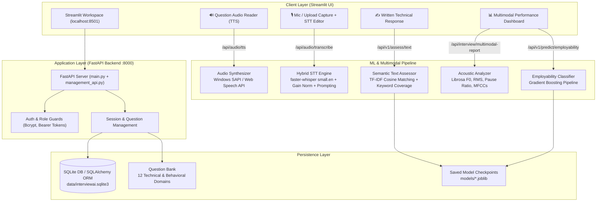
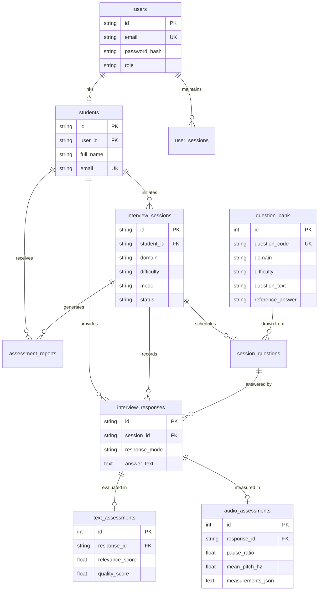

# InterviewAI – Intelligent Multimodal Mock Interview Assessment System

[](https://www.python.org/)
[](https://fastapi.tiangolo.com/)
[](https://streamlit.io/)
[](https://github.com/SYSTRAN/faster-whisper)
[](https://librosa.org/)
[](https://scikit-learn.org/)
[]()

**InterviewAI** is an end-to-end multimodal machine learning system for conducting realistic technical and behavioral mock interviews. It evaluates candidate responses across two complementary modalities:
1. **Semantic Text & Domain Alignment:** Real-time NLP scoring comparing candidate answers against curated expert reference solutions using TF-IDF cosine similarity, expected concept coverage, and structural coherence heuristics.
2. **Acoustic & Prosodic Speech Analysis:** Signal extraction via Librosa (fundamental frequency F0 pitch, speaking rate, pause-to-speech ratio, RMS energy, and 13 MFCC coefficients) combined with local automatic speech-to-text (STT) and question read-aloud text-to-speech (TTS).
3. **Employability Prediction:** Soft-skill competency classification leveraging a trained Gradient Boosting classifier with calibrated feature scaling and decision bounds.

---

## Table of Contents

- [System Architecture](#system-architecture)
- [Key Features](#key-features)
- [Multimodal Evaluation Engine](#multimodal-evaluation-engine)
  - [1. Semantic Text Pipeline](#1-semantic-text-pipeline)
  - [2. Acoustic Feature Extraction Pipeline](#2-acoustic-feature-extraction-pipeline)
  - [3. Speech-to-Text (STT) & Contextual Prompting](#3-speech-to-text-stt--contextual-prompting)
  - [4. Text-to-Speech (TTS) Question Playback](#4-text-to-speech-tts-question-playback)
  - [5. Soft-Skill Employability Classifier](#5-soft-skill-employability-classifier)
- [Technology Stack](#technology-stack)
- [Repository Structure](#repository-structure)
- [Database Schema](#database-schema)
- [API Reference](#api-reference)
- [Installation & Quickstart Guide](#installation--quickstart-guide)
- [Testing & Verification](#testing--verification)
- [Recent Hardening & Bug Fixes](#recent-hardening--bug-fixes)
- [Contributing & License](#contributing--license)

---

## System Architecture



---

## Key Features

* **Interactive Voice Panel:**
  * **AI Interviewer Audio Reader (TTS):** Candidates can listen to technical interview questions read aloud using synthesized audio before recording answers.
  * **Acoustic Voice Capture:** High-fidelity microphone input or file upload (`.wav`, `.mp3`, `.m4a`, `.webm`, `.flac`) with persistent session buffering.
  * **Domain-Conditioned Speech-to-Text (STT):** Local, offline Whisper transcription primed with question context and technical keywords, preventing domain mishearings.
  * **Interactive Transcript Review:** An editable transcript area allows candidates to review, adjust, and save transcribed speech drafts.
* **Semantic Text Assessment:**
  * TF-IDF vectorization with sublinear term-frequency scaling and 1–2 n-grams.
  * Reference answer cosine similarity and question alignment heuristics.
  * Automated generation of concrete strengths, areas of coaching, and structured answer templates.
* **Comprehensive Acoustic Diagnostics:**
  * Fundamental pitch ($F_0$) tracking via YIN algorithm, identifying monotone vs expressive delivery.
  * Pause-to-speech ratio and silent interval duration tracking to measure speaking cadence.
  * RMS energy measurement to detect vocal projection and volume consistency.
  * 13-band Mel-Frequency Cepstral Coefficients (MFCCs).
* **Employability Prediction:**
  * 5 soft-skill rating vectors (Manner of Speaking, Mental Alertness, Self-Confidence, Presentation, Communication).
  * Pre-trained Gradient Boosting classifier (Validation ROC-AUC: **0.835**, Test ROC-AUC: **0.825**).
* **Enterprise-Grade Session Management:**
  * User authentication with bcrypt password hashing and token-based session invalidation.
  * Relational database supporting question banks, ordered session sequences, response drafts, and versioned evaluation reports.
  * SQLite batch-compatible Alembic migrations.

---

## Multimodal Evaluation Engine

### 1. Semantic Text Pipeline
Located in `src/text_pipeline.py`, the `InterviewTextAssessor` evaluates candidate answers using a 4-component weighted heuristic:

$$\text{Quality Score} = 0.50 \times S_{\text{relevance}} + 0.20 \times S_{\text{alignment}} + 0.15 \times S_{\text{keyword}} + 0.15 \times S_{\text{structure}}$$

* **Reference Cosine ($S_{\text{relevance}}$):** Vector cosine similarity between candidate answer and domain expert benchmark answer.
* **Question Alignment ($S_{\text{alignment}}$):** Semantic similarity ensuring the candidate directly addresses the question asked.
* **Keyword Coverage ($S_{\text{keyword}}$):** Jaccard index measuring presence of essential domain terminology and expected concepts.
* **Structural Coherence ($S_{\text{structure}}$):** Heuristic analysis rewarding logical transition connectors (`specifically`, `in contrast`, `therefore`, `firstly`).

### 2. Acoustic Feature Extraction Pipeline
Located in `src/audio_feature_extractor.py`, the `CandidateAudioAnalyzer` uses Librosa to compute:
* **Pitch Statistics:** Mean, standard deviation, minimum, and maximum fundamental frequency ($F_0$) in Hertz.
* **Cadence & Pacing:** Speaking duration vs total duration, pause count, and pause ratio. Conversational target range: `0.08` to `0.35`.
* **Energy (RMS):** Root-mean-square energy across frames to evaluate loudness stability.
* **Spectral Envelope:** 13-dimensional mean MFCC vectors capturing vocal timbre.

### 3. Speech-to-Text (STT) & Contextual Prompting
Located in `backend/transcription_service.py` and `src/whisper_worker.py`:
* **Engine:** `faster-whisper` (`small.en` model running locally in 8-bit integer quantization on CPU).
* **Acoustic Gain Normalization:** Automatically amplifies low-volume microphone recordings to 95% full dynamic range before feature extraction, ensuring clear phoneme recognition.
* **Decoder Context Conditioning (`initial_prompt`):** Dynamic question context is injected into Whisper's decoder prompt. This eliminates acoustic misclassifications (e.g., preventing *"overfitting"* from being misheard as *"COVID-19"* or *"over particular"*).
* **Isolated Subprocess Fallback:** Runs in an isolated worker process to ensure reliability under strict Windows Application Control and AppLocker environments, with fallback to Google SpeechRecognition if needed.

### 4. Text-to-Speech (TTS) Question Playback
Located in `backend/main.py` (`/api/audio/tts`) and `frontend/pages/interview_workspace.py`:
* Synthesizes question text into clean PCM 16-bit `.wav` audio using native system speech synthesizers.
* Caches generated audio in `data/tts_cache/` to ensure instantaneous response times on repeated questions.
* Includes dual-layer frontend fallback: if native audio streaming is unavailable, it activates the browser's HTML5 Web Speech API (`SpeechSynthesisUtterance`).

### 5. Soft-Skill Employability Classifier
Located in `models/gradient_boosting_employability.joblib`:
* **Input Dimensions:** 5 core ratings (1–5 scale) + 2 engineered interaction features (`soft_skill_mean`, `soft_skill_min`).
* **Model Benchmark Scores:**
  * **Gradient Boosting:** Test Accuracy **76.88%**, Test F1 **0.8222**, Test ROC-AUC **0.8248**
  * **SVM:** Test Accuracy **75.88%**, Test F1 **0.8105**, Test ROC-AUC **0.7926**
  * **Random Forest:** Test Accuracy **74.20%**, Test F1 **0.7806**, Test ROC-AUC **0.8132**

---

## Complete Technology Stack

| Category | Technology | Version | Purpose |
|---|---|---|---|
| **Core Runtime** | Python | 3.11+ / 3.14 | Backend, ML inference, and CLI tools |
| **Backend API** | FastAPI | `>=0.100.0` | High-performance asynchronous REST endpoints |
| **Server Engine** | Uvicorn | `>=0.23.0` | ASGI application server |
| **Frontend UI** | Streamlit | `>=1.40.0` | Interactive web dashboard and interview workspace |
| **Speech-to-Text** | faster-whisper | `1.2.1` | Local quantized Whisper ASR (`small.en`, CPU int8) |
| **Acoustic Processing**| Librosa, SoundFile | `>=0.10.0` | Pitch YIN, MFCC, and pause segmentation |
| **Machine Learning** | scikit-learn | `>=1.2.0` | Gradient Boosting classifier and TF-IDF pipelines |
| **Database & ORM** | SQLAlchemy, SQLite | `2.x` | Persistent relational store with WAL mode |
| **Migrations** | Alembic | `1.13+` | Batch-compatible SQLite schema migrations |
| **Authentication** | Bcrypt | `>=4.0` | Secure password hashing and token management |

---

## Repository Structure

```text
Multimodal-Mock-Interview/
├── README.md                                      # Complete project documentation
├── .gitignore                                     # Ignored patterns and cache directories
├── Intelligent_Mock_Interview/
│   ├── backend/
│   │   ├── main.py                                # FastAPI application, inference & TTS routes
│   │   ├── management_api.py                      # Authentication, session, and question CRUD
│   │   └── transcription_service.py               # Singleton faster-whisper service with worker bridge
│   ├── frontend/
│   │   ├── app.py                                 # Streamlit main entrypoint & navigation
│   │   ├── pages/
│   │   │   ├── auth_page.py                       # User registration and login
│   │   │   ├── dashboard.py                       # Student performance overview
│   │   │   ├── interview_workspace.py             # Active interview environment (STT, TTS, NLP)
│   │   │   ├── new_assessment.py                  # Domain and difficulty session creator
│   │   │   ├── assessment_history.py              # Historical assessment scores and review
│   │   │   ├── question_bank.py                   # Question repository browser
│   │   │   └── system_status.py                   # Hardware and service diagnostics
│   │   ├── services/
│   │   │   └── api_client.py                      # Frontend HTTP client for FastAPI endpoints
│   │   └── components/
│   │       └── ui.py                              # Modular badges, cards, and status pills
│   ├── src/
│   │   ├── text_pipeline.py                       # NLP semantic scoring and feedback generator
│   │   ├── audio_feature_extractor.py             # Librosa pitch, pause, and MFCC extractor
│   │   ├── whisper_worker.py                      # Isolated faster-whisper & SpeechRecognition worker
│   │   ├── database.py                            # SQLAlchemy ORM schema and seed loader
│   │   ├── auth.py                                # Password hashing and session token logic
│   │   ├── test_fixes.py                          # Unit tests for models and multimodal fusion
│   │   ├── test_voice_interview_api.py            # API tests for transcription & assessment
│   │   ├── test_ui_and_features.py                # End-to-end pipeline validation suite
│   │   └── test_multimodal_complete.py            # Multimodal contract and edge-case tests
│   ├── models/
│   │   ├── gradient_boosting_employability.joblib # Production employability model
│   │   ├── interview_tfidf_vectorizer.joblib      # 10k-feature TF-IDF vectorizer
│   │   └── employability_model_meta.json          # Model metadata and cross-validation metrics
│   ├── data/
│   │   ├── question_bank_seed.json                # Seed technical questions (12 domains)
│   │   └── tts_cache/                             # Cached WAV speech audio files
│   └── alembic/                                   # Database migration scripts
```

---

## Database Schema



---

## API Reference

### Health & Capabilities
* `GET /` - Root service metadata and loaded transcription provider.
* `GET /health` - Diagnostic health check reporting Whisper device and model status.
* `GET /api/v1/models/meta` - Serves benchmark metrics and metadata for saved ML classifiers.

### Voice, STT & TTS Endpoints
* `POST /api/audio/transcribe` - Transcribes audio payload (`multipart/form-data`) using faster-whisper with optional technical context `prompt`.
* `POST /api/audio/tts` & `GET /api/audio/tts?text=...` - Generates high-quality WAV audio for question read-aloud playback.
* `GET /api/audio/recordings/{filename}` - Streams saved candidate audio recordings with dynamic MIME resolution.

### Assessment & Inference Endpoints
* `POST /api/v1/assess/text` - Evaluates written response against reference answer and question context.
* `POST /api/interview/multimodal-report` - Runs simultaneous text NLP evaluation and Librosa acoustic feature extraction on candidate audio.
* `POST /api/v1/predict/employability` - Predicts employability class and probability from 5 soft-skill ratings.

### Session & Question Management
* `GET /api/questions/domains` - Returns all distinct question domains in the database.
* `GET /api/questions` - Lists and filters questions by domain, difficulty, or search term.
* `POST /api/sessions` - Configures a new randomized interview session.
* `GET /api/sessions/{session_id}` - Retrieves session state, question sequence, and saved responses.
* `PUT /api/sessions/{session_id}/questions/{position}/response` - Saves or updates response draft.
* `GET /api/sessions/{session_id}/reports/final` - Compiles and returns the comprehensive assessment report.

---

## Installation & Quickstart Guide

### Prerequisites
* **Operating System:** Windows 10/11, macOS, or Linux.
* **Python:** Version `3.11.x` recommended (compatible with `3.10`–`3.14`).
* **Microphone:** Required for voice recording.

### 1. Clone the Repository
```bash
git clone https://github.com/ARYANKUMAR210107/Multimodal-Mock-Interview.git
cd Multimodal-Mock-Interview
```

### 2. Set Up Virtual Environment & Dependencies
```bash
# Windows PowerShell
python -m venv venv
.\venv\Scripts\Activate.ps1

# Linux / macOS
python3 -m venv venv
source venv/bin/activate

# Install dependencies
cd Intelligent_Mock_Interview
pip install --upgrade pip
pip install -r requirements.txt
```

### 3. Start the FastAPI Backend Server
In your first terminal:
```bash
# From Intelligent_Mock_Interview directory:
python -m uvicorn backend.main:app --host 127.0.0.1 --port 8000 --reload
```
* Backend API will be available at: [http://127.0.0.1:8000](http://127.0.0.1:8000)
* Interactive Swagger Docs: [http://127.0.0.1:8000/docs](http://127.0.0.1:8000/docs)

### 4. Start the Streamlit Frontend Web App
In a second terminal:
```bash
# From Intelligent_Mock_Interview directory:
python -m streamlit run frontend/app.py --server.port 8501
```
* Frontend Dashboard will open at: [http://localhost:8501](http://localhost:8501)

---

## Testing & Verification

The repository includes a comprehensive verification suite validating every ML pipeline, acoustic extraction contract, and API route:

```bash
cd Intelligent_Mock_Interview

# 1. Verify ML Pipelines & Employability Model Deserialization
python src/test_fixes.py

# 2. Verify FastAPI Voice Endpoints, STT & Error Handling (15 tests)
python src/test_voice_interview_api.py

# 3. Verify End-to-End Real Audio Processing & Librosa Extraction
python src/test_ui_and_features.py

# 4. Verify Multimodal Contracts & Boundary Behavior (13 tests)
python src/test_multimodal_complete.py
```

### Verification Results Summary
```text
[PASS] test_fixes.py                -> 3/3 Checks Verified (GB Pipeline, Fusion, Model Meta)
[PASS] test_voice_interview_api.py  -> 15/15 Tests OK (Whisper ASR, Audio Validation, Error Codes)
[PASS] test_ui_and_features.py      -> All Tests Passed (100% Real Pipeline Audio Data)
[PASS] test_multimodal_complete.py  -> 13/13 Tests OK (Acoustic and Semantic Contracts)
[PASS] TTS Synthesis Endpoint       -> HTTP 200 OK (Clean WAV Audio Generated & Streamed)
```

---

## Recent Hardening & Bug Fixes

1. **Voice Panel STT State Binding:** Resolved a Streamlit widget key desynchronization bug where transcribed text failed to display in the reviewed transcript text area upon rerun.
2. **Technical Domain Hallucination Reduction:** Solved phonetic mishearings in Whisper (e.g. *"COVID-19"* instead of *"overfitting"*) by upgrading from `base.en` to **`small.en`**, adding dynamic question context prompts (`initial_prompt`), and adding 95% peak volume normalization.
3. **Full Text-to-Speech (TTS) Integration:** Implemented `/api/audio/tts` with native system speech generation and dual-layer interactive audio buttons in question cards and workspace tabs.
4. **SQLite Batch Migration Support:** Wrapped table and index drops in Alembic migrations using `with op.batch_alter_table(...)` to prevent SQLite constraint failures.
5. **Session Security:** Configured `change_user_password` to invalidate all active session tokens upon password reset to prevent session hijacking.
6. **Path Portability:** Replaced all hardcoded developer paths with relative path calculation derived from `__file__`.

---

## Contributing & License

Contributions, bug reports, and pull requests are welcome. Please ensure that all tests run cleanly via `python src/test_voice_interview_api.py` and `python src/test_fixes.py` before submitting a pull request.

**License:** MIT License. See [LICENSE](LICENSE) for details.
